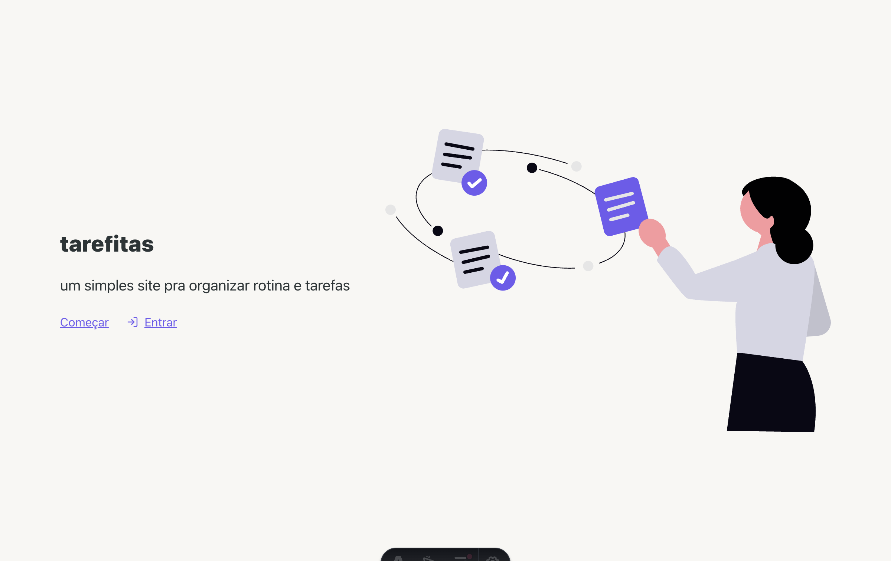
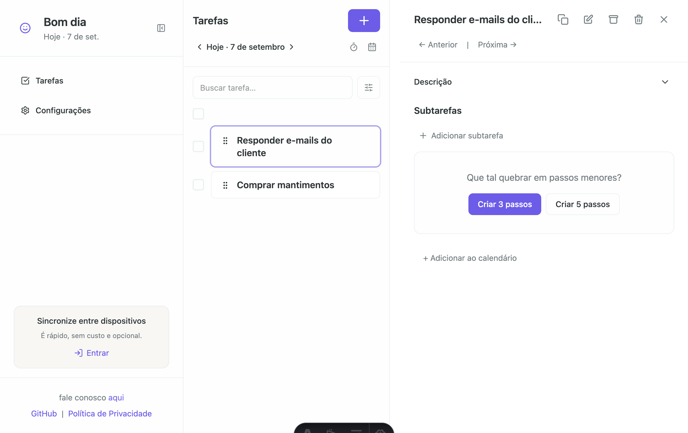
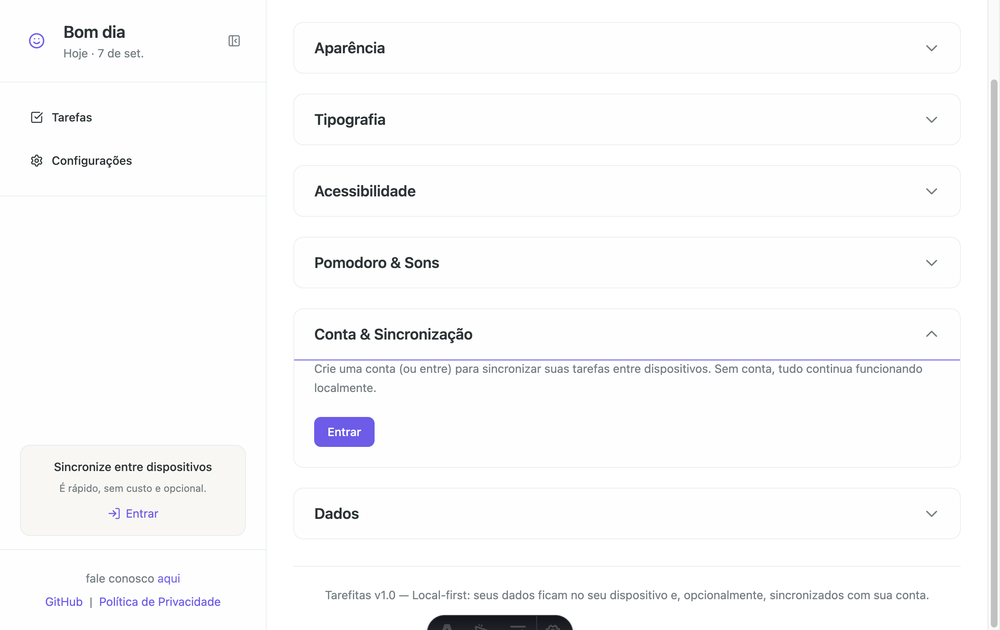
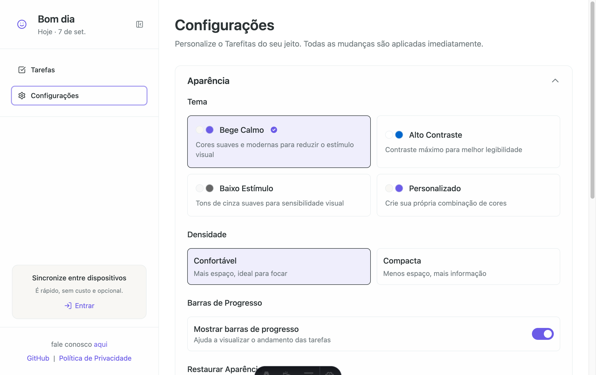

# Tarefitas

O Tarefitas é um aplicativo local-first para organizar rotinas e tarefas. Ele
funciona sem conta e mantém os dados no navegador por padrão. Se você quiser
usar os mesmos dados em mais de um dispositivo, pode ativar a sincronização
opcional com o Supabase.

Você pode testar a versão publicada em [tarefitas.netlify.app](https://tarefitas.netlify.app/).

## O que você pode fazer

- Organizar tarefas, subtarefas e rotinas.
- Usar um timer Pomodoro.
- Manter os dados no navegador por padrão, sem ativar uma conta ou sincronização.
- Criar uma conta e sincronizar os dados entre dispositivos, se quiser.
- Ajustar aparência, som e preferências de acessibilidade.

## Screenshots

| Tela inicial | Lista de tarefas |
|:---:|:---:|
|  |  |

| Conta e sincronização | Configurações |
|:---:|:---:|
|  |  |

## Executar localmente

Você precisa ter o Node.js e o [pnpm](https://pnpm.io/installation) instalados.

```bash
pnpm install
pnpm dev
```

Abra `http://localhost:4321` no navegador.

Sem configurar o Supabase, o aplicativo continua funcionando no modo local. A
sincronização é opcional.

## Ativar a sincronização

A sincronização usa o Supabase para que a mesma conta acesse os dados em mais de
um dispositivo.

### 1. Criar um projeto no Supabase

Crie um projeto no [painel do Supabase](https://supabase.com/dashboard). O plano
gratuito é suficiente para desenvolvimento.

### 2. Criar as tabelas

No **SQL Editor** do projeto, execute uma vez o arquivo
[`supabase/schema.sql`](supabase/schema.sql). O script cria as tabelas de
`tasks`, `subtasks`, `settings` e `profile`, configura as políticas de segurança
por conta e ativa o realtime.

Se as tabelas foram criadas com uma versão anterior do projeto, execute também
[`supabase/migrate-camelcase.sql`](supabase/migrate-camelcase.sql) uma vez. Ele
corrige os nomes das colunas e recria as políticas RLS.

### 3. Configurar as variáveis de ambiente

Copie o arquivo de exemplo:

```bash
cp .env.example .env
```

Preencha estas variáveis no `.env`:

| Variável | Valor |
|---|---|
| `PUBLIC_SUPABASE_URL` | A `Project URL`, sem barra no final. |
| `PUBLIC_SUPABASE_ANON_KEY` | A chave pública `anon` do projeto. |

As variáveis `PUBLIC_POSTHOG_HOST`, `PUBLIC_POSTHOG_KEY` e
`PUBLIC_GA4_MEASUREMENT_ID` são opcionais. Sem elas, essas integrações não
enviam dados.

### 4. Criar uma conta

Inicie o aplicativo e abra **Configurações → Conta & Sincronização**. Depois de
criar uma conta e entrar, os dados locais são associados à conta e podem ser
acessados em outros dispositivos.

Por padrão, o Supabase exige confirmação por e-mail. Para permitir que uma conta
seja ativada imediatamente durante o desenvolvimento, desative **Authentication
→ Sign In / Up → Confirm e-mail** no painel do Supabase.

Em **Authentication → URL Configuration → Redirect URLs**, adicione a rota
`https://SEU-DOMINIO/app/tarefas` para o retorno do login com Google. Em
produção, substitua `SEU-DOMINIO` pelo domínio publicado.

### Segurança

O aplicativo usa apenas a URL do projeto e a chave pública `anon` no navegador.
O controle de acesso é feito pelas políticas de Row Level Security (RLS): cada
conta só pode acessar os próprios dados.

Nunca coloque a chave `service_role` no `.env` usado pelo aplicativo ou no
código enviado ao navegador.

## Arquitetura

O armazenamento local usa [RxDB](https://rxdb.info/) sobre
[IndexedDB](https://developer.mozilla.org/en-US/docs/Web/API/IndexedDB_API), com
[Dexie](https://rxdb.info/rx-storage-dexie.html) como storage adapter.

- `src/lib/rxdb/database.ts` cria o banco e as coleções `tasks`, `subtasks`,
  `settings` e `profile`.
- `src/lib/rxdb/bridge.ts` traduz entre os documentos do banco e os atoms do
  Nanostores. É o ponto único de mapeamento entre persistência e domínio.
- `src/stores/` fornece a fachada reativa usada pelos componentes.
- `src/lib/rxdb/replication.ts` inicia ou encerra a replicação conforme o estado
  de autenticação.

Quando a sincronização está ativa, o plugin oficial
[`replicateSupabase`](https://rxdb.info/replication-supabase.html) faz pull e
push incrementais, processa checkpoints e recebe atualizações em tempo real.
Os componentes da interface não precisam conhecer os detalhes do Supabase.

## Comandos

| Comando | Função |
|---|---|
| `pnpm install` | Instala as dependências. |
| `pnpm dev` | Inicia o servidor de desenvolvimento em `localhost:4321`. |
| `pnpm exec astro check` | Executa a verificação de tipos do Astro. |
| `pnpm build` | Gera o build de produção em `dist/`. |
| `pnpm preview` | Serve o build de produção localmente. |

## Estrutura do projeto

```text
src/
  components/   # Componentes Astro e React
  lib/rxdb/     # Banco local, schema e sincronização
  pages/        # Rotas da aplicação
  stores/       # Estado reativo
  utils/        # Funções auxiliares
supabase/
  schema.sql    # Tabelas, RLS e realtime da sincronização
public/         # Arquivos públicos e screenshots
```

## Documentação

- [Política de privacidade](/privacidade)
- [Como contribuir](CONTRIBUTING.md)
- [Licença MIT](LICENSE)

## Stack

[Astro](https://astro.build/) + [React](https://react.dev/) +
[Nanostores](https://github.com/nanostores/nanostores) +
[Tailwind CSS](https://tailwindcss.com/) + [RxDB](https://rxdb.info/) +
[Supabase](https://supabase.com/).
